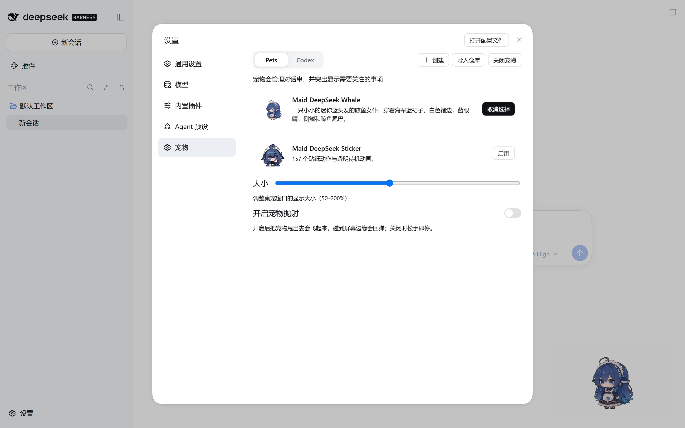

<div align="center"><a name="readme-top"></a>
# DSH Pet Lite
  
[![npm version][npm-version-src]][npm-version-href]
[![npm downloads][npm-downloads-src]][npm-downloads-href]
[![bundle][bundle-src]][bundle-href]
[![JSDocs][jsdocs-src]][jsdocs-href]
[![License][license-src]][license-href]
为 DeepSeek Harness (DSH) 提供一只独立置顶的桌面宠物：会话在忙什么，它就做什么表情，并把需要你注意的事项顶在气泡里。
</div>

## 📦 安装

在官方插件中安装 `dsh-pet-lite`

or

或使用命令行安装
```sh
dsh plugin --profile web add dsh-pet-lite
```

- 在 **设置 → 插件** 中启用。

## ✨ 特性
- 🐾 **独立窗口**：透明、无边框、置顶；整窗点击穿透，指针进到宠物身上才可交互。
- 🎭 **会话驱动**：订阅会话活动，按六档工作状态（思考 / 执行 / 结果 / 等待 / 成功 / 出错）切换动作，并顶出对应气泡。
- 🖱️ **拖动与甩抛**：拖动时窗口跟随指针；开启抛射后甩出去会飞起来、碰到屏幕边缘回弹，关闭时松手即停。
- 🎛️ **设置分区**：**设置 → 宠物** 一处完成选择、启用 / 关闭、大小（50–200%）与抛射开关，改完立刻作用到已打开的窗口。
- 🐳 **内置预设**：Maid DeepSeek Whale、Maid DeepSeek Sticker、Claude、Chat GPT 开箱即选，不下载、不安装。
- 📦 **导入与登记**：Codex `.zip` 资源包一键导入；填 `owner/repo` 即可登记 GitHub 上的宠物，只存资源地址、选中后按需播放。
- 🔄 **更新与删除**：按仓库最新提交判断能否更新；删除远端条目即反注册，来源限定的条目连本地目录一起删掉。
- 🖥️ **右键菜单**：**显示主界面** 唤起宿主窗口，**关闭宠物** 与设置页走同一条路径。

## 🚀 快速开始

### 养一只宠物

1. 打开 **设置 → 宠物**，点 **创建**。
2. 新建的桌宠会话会在输入框里自动填好 `/hatch-dsh-pet 根据你对我的了解，养一只宠物`。
3. 回车，让 Agent 按它对你的了解孵一只出来；也可以直接用内置预设。
4. 点 **启用宠物** 打开桌宠窗口。

### 换宠物与调手感



1. 分两页：**Pets** 是内置预设与本地导入，**Codex** 是 Codex 图集。
2. 卡片上 **启用 / 选择** 换宠物，**取消选择** 收起当前的；**删除** 只对可管理的条目出现。
3. 拖 **大小** 滑条调整显示尺寸；开 **开启宠物抛射** 让宠物甩得飞起来。
4. **导入仓库** 填 `owner/repo` 登记远端宠物；**导入** 选择 Codex `.zip` 资源包；**社区分享** 在浏览器打开 Codex 宠物社区。
5. 再次点击右上角账号菜单里的 **启用宠物 / 关闭宠物**，也能随手开关。

### 和宠物玩
1. 拖动：按住宠物拖到屏幕任意位置，松手后它会停在原地。
2. 甩抛：开启抛射后快速甩动，宠物会飞出去并撞边回弹。
3. 右键：**显示主界面** 或 **关闭宠物**。
4. 点击穿透：窗口透明区域不挡鼠标，只有指针进到宠物身上才会响应。

## 📚 配置与限制
- **GitHub 限流**：登记与更新检查走 GitHub API，匿名额度是 60 次/小时/IP；设 `GITHUB_TOKEN` 或 `GH_TOKEN` 可换 5000 次/小时。
- **仓库登记**：只认 `raw.githubusercontent.com`，`kind` 必须为 `dsh`；只登记资源地址，不下载视频包。
- **数据位置**：`$DSH_HOME/pet-lite/`，设置与已登记仓库都在这里。
- **Wayland**：桌宠窗口来自 Electron，不是 X11/Wayland 原生窗口，设置里的强制 XWayland 开关不适用。

## 🛠️ 开发与贡献
```sh
pnpm install
pnpm run lint
pnpm run typecheck
pnpm run test
pnpm run build
```

## 📜️ 许可证
- [MIT](<LICENSE.md>)

<!-- Badges -->
[npm-version-src]: https://img.shields.io/npm/v/dsh-pet-lite?style=flat&colorA=080f12&colorB=1fa669
[npm-version-href]: https://npmjs.com/package/dsh-pet-lite
[npm-downloads-src]: https://img.shields.io/npm/dm/dsh-pet-lite?style=flat&colorA=080f12&colorB=1fa669
[npm-downloads-href]: https://npmjs.com/package/dsh-pet-lite
[bundle-src]: https://img.shields.io/bundlephobia/minzip/dsh-pet-lite?style=flat&colorA=080f12&colorB=1fa669&label=minzip
[bundle-href]: https://bundlephobia.com/result?p=dsh-pet-lite
[license-src]: https://img.shields.io/github/license/hairyf/dsh-pet-lite.svg?style=flat&colorA=080f12&colorB=1fa669
[license-href]: https://github.com/hairyf/dsh-pet-lite/blob/main/LICENSE.md
[jsdocs-src]: https://img.shields.io/badge/jsdocs-reference-080f12?style=flat&colorA=080f12&colorB=1fa669
[jsdocs-href]: https://www.jsdocs.io/package/dsh-pet-lite
