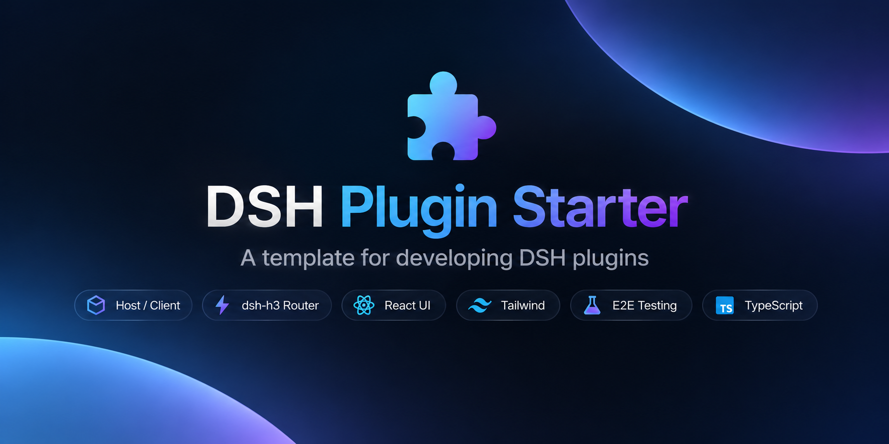

<p align='center'>
  
</p>

<h1 align='center'>DSH Plugin Starter</h1>

<p align='center'>
基于 <a href="https://github.com/deepseek-ai/dsh">DeepSeekRuntime</a> 的插件起步模板 — Host / Client 双端、按方法拆分的 HTTP 路由、构建在官方组件之上的 React UI，以及对真实 DSH 外壳的浏览器端 E2E。
<br>
<br>
<a href="https://github.com/dsh-tauri/starter-plugin/generate"><strong>Use this template</strong></a>
</p>

<!-- Badge -->

[![npm version][npm-version-src]][npm-version-href]
[![npm downloads][npm-downloads-src]][npm-downloads-href]
[![bundle][bundle-src]][bundle-href]
[![JSDocs][jsdocs-src]][jsdocs-href]
[![License][license-src]][license-href]

## 特性

- 🧩 **两段构建** — Host 插件与 Client 模块分开打包，由 [tsdown](https://tsdown.dev) 一次产出
- 🗂️ **每个文件都有归处** — 共享类型、常量、HTTP 路由、组件、Slot id 各有既定位置，不会都堆进一个 `utils.ts`
- 🖥️ **[dsh-h3](https://github.com/hairyf/dsh-h3) 路由** — `src/server/routes/` 下一个 HTTP 方法一个文件，通过 `defineWebServer` 挂载
- ⚛️ **基于官方组件** — 组件集中在 `src/client/components`，复用 `@deepseek-ai/dsh-client-ui-*`，不重复造 UI
- 🎨 **Tailwind** — `src/main.css` 未编译的 [dsh-taiwind](https://github.com/hairyf/dsh-taiwind) 入口，由 bundle patch 注入
- 🧪 **真实浏览器 E2E** — 基于 [vitest/browser](https://vitest.dev/api/browser/commands.html) + Playwright 启动 DSH，并断言控制台零错误
- 🧠 **所需技能已备齐** — 通过安装依赖将 Cordis 插件开发、composition 配置以及其他相关技能。
- 🦾 **TypeScript strict、ESM、pnpm catalog、`@antfu/eslint-config`** — 当然
- ⚙️ **三平台 CI** — Ubuntu / Windows / macOS + Node 24，另有 tag 触发的 npm 发布
- 📦 **直接发布** — `exports`、`files` 与 `publint` 保证产物结构和类型声明可用

## 预置内容

### Host 端

| 依赖 | 用途 |
| --- | --- |
| `@deepseek-ai/cordis` | 插件运行时与 `apply(ctx)` 生命周期 |
| `dsh-h3` / `h3` | HTTP 路由与请求处理 |
| `@deepseek-ai/dsh-host-webserver` | `defineWebServer` 服务入口 |
| `@deepseek-ai/dsh-tools`、`dsh-session`、`dsh-workspace` | 工具、会话与工作区服务 |

### Client 端

| 依赖 | 用途 |
| --- | --- |
| `@deepseek-ai/dsh-client-store` | 唯一允许使用的状态容器，不另建替代 Store |
| `@deepseek-ai/dsh-client-ui-slots` | 以稳定 id 注册 Slot |
| `@deepseek-ai/dsh-client-ui-primitives` | 官方组件，经 `components/official.ts` 统一导出 |
| `@deepseek-ai/dsh-client-ui-{layout,conversation,session,settings,theme,workspace}` | 外壳暴露的全部 Slot 位置 |

两端的声明都在 `package.json` 里：`dsh.client.inject` 列出 client 需要的服务，`dsh.client.platform` 为 `web`，`dsh.bundle.patch` 指向 `cordis.patch.yml` —— 在那里注册你的插件 id 与 `dsh-taiwind`。

### 工具链

| 依赖 | 用途 |
| --- | --- |
| [tsdown](https://tsdown.dev) | 双入口打包：ESM host + CJS client 工厂 |
| [Vitest](https://vitest.dev) | unit project 与 Playwright 驱动的 e2e project |
| [@antfu/eslint-config](https://github.com/antfu/eslint-config) | 代码风格与格式化，不用 Prettier |
| [bumpp](https://github.com/antfu/bumpp) | 版本号提升与发布提交 |

## 快速开始

### 通过 Harness 创建

在 DeepSeekRuntime 里直接说需求，由 [dsh-plugin-creator](https://github.com/hairyf/skills) 这条 skill 用本模板建仓并实现：

安装技能：

```bash
npx skills add hairyf/skills --skill dsh-plugin-creator -g
```

> 在 Harness 中对话：/dsh-plugin-creator 做一个 XX 插件，目录放 `some/path`，仓库归属 `owner/repo`（public）

它将覆盖插件全流程开发 —— 用模板建仓库、实现 Host / Client、本地校验、推送，以及盯 CI。

## 使用

### 开发

```bash
pnpm run dev   # tsdown --watch，两端一起增量构建
```

调试时把插件装进一次性的 DSH profile，别装进你日常用的那个：

```bash
pnpm run build
pnpm pack --pack-destination .tmp
DSH_HOME=$(mktemp -d) dsh plugin --profile web add ./.tmp/*.tgz
DSH_HOME="$DSH_HOME" dsh --profile web
```

client 产物是 `dist/client.cjs`，加载器入口由 [tsdown.config.ts](./tsdown.config.ts) 里的 `banner` / `footer` 生成，因此工厂函数的导出不能丢。

### 脚本

| 脚本 | 作用 |
| --- | --- |
| `pnpm run dev` | 监听改动增量构建 |
| `pnpm run build` | tsdown 构建两端产物 |
| `pnpm run lint` | ESLint，加 `--fix` 自动修复 |
| `pnpm run typecheck` | `tsc`，`noEmit` |
| `pnpm run test` | 先构建，再跑两个 Vitest project |
| `pnpm run release` | `bumpp` 提升版本、提交、打 tag |

### 测试

两个 Vitest project，按路径切分：

- **unit** —— `test/**/*.test.ts`，排除 `test/e2e`，快，不启浏览器。
- **e2e** —— `test/e2e/**/*.{test,spec}.{ts,tsx}`，通过 `@vitest/browser-playwright` 在无头 Chromium 里串行执行。

e2e 跑的是真实外壳：构建 → 打包 → 装进临时 `DSH_HOME` → 在空闲端口起 `dsh --profile web --no-open` → 用启动 token 换 `SameSite=Strict` Cookie → 断言页面无控制台错误。前置条件：

```bash
pnpm exec playwright install chromium
pnpm add -g @deepseek-ai/dsh@0.2.1-rc.5
```

`dsh` 从 `PATH` 查找，或用 `DSH_E2E_DSH` / `DSHM_E2E_DSH` 指定。找不到时 e2e 会跳过，设 `DSH_E2E_REQUIRED=1` 则改为失败（CI 就是这样）。

```bash
pnpm run test -- --run                    # 全部
pnpm exec vitest run --project unit       # 只跑单测
pnpm exec vitest run --project e2e        # 只跑浏览器
```

交付前把整套门禁跑一遍：

```bash
pnpm run lint --fix
pnpm run typecheck
pnpm run test -- --run
pnpm run build
```

## 发布

模板默认走 [npm Trusted Publisher](https://github.com/e18e/ecosystem-issues/issues/201)：发布在 CI 上完成，产物可追溯到具体 tag。

1. 首次用 `pnpm publish` 手工建包（此时还没有 Trusted Publisher）。
2. 在 `https://www.npmjs.com/package/<name>/access` 绑定仓库。
3. 之后 `pnpm run release` 打 tag 并推送，[`.github/workflows/release.yml`](./.github/workflows/release.yml) 凭 `id-token: write` 发布。

分支 CI 是 [`.github/workflows/ci.yml`](./.github/workflows/ci.yml)：Ubuntu / Windows / macOS + Node 24 上跑 lint、typecheck、build 和测试。

## 检查清单

- [ ] `package.json` **和** `cordis.patch.yml` 里的 `pkg-placeholder` 替换
- [ ] 替换 `_description_`、`author`、`homepage`、`repository`、`bugs`
- [ ] 不需要的徽章不要删，发布 npm 后将自动更新
- [ ] 第一次开 agent 会话前，确保 `pnpm install` 拉取需要的工作 `skills`
- [ ] 只有真的从 `dist/` 发布才保留它，且永远不要手动修改

## License

[MIT](./LICENSE.md) License © [dsh-tauri](https://github.com/dsh-tauri)

<!-- Badges -->

[npm-version-src]: https://img.shields.io/npm/v/pkg-placeholder?style=flat&colorA=080f12&colorB=1fa669
[npm-version-href]: https://npmx.dev/package/pkg-placeholder
[npm-downloads-src]: https://img.shields.io/npm/dm/pkg-placeholder?style=flat&colorA=080f12&colorB=1fa669
[npm-downloads-href]: https://npmx.dev/package/pkg-placeholder
[bundle-src]: https://img.shields.io/bundlephobia/minzip/pkg-placeholder?style=flat&colorA=080f12&colorB=1fa669&label=minzip
[bundle-href]: https://bundlephobia.com/result?p=pkg-placeholder
[license-src]: https://img.shields.io/github/license/dsh-tauri/starter-plugin.svg?style=flat&colorA=080f12&colorB=1fa669
[license-href]: https://github.com/dsh-tauri/starter-plugin/blob/main/LICENSE.md
[jsdocs-src]: https://img.shields.io/badge/jsdocs-reference-080f12?style=flat&colorA=080f12&colorB=1fa669
[jsdocs-href]: https://www.jsdocs.io/package/pkg-placeholder
